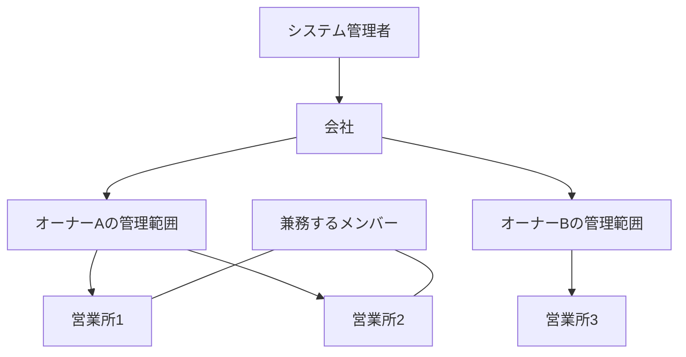

# 訪問のアトリエ Web版 基本設計書

作成日：2026年10月4日  
版：初期設計 0.2  
作成先：`E:\app\ShiftForWeb`

以下は目標仕様です。Web版0.1.0の実装済み機能と差分は[実装状況](docs/IMPLEMENTATION_STATUS.md)に記録しています。

この文書は、ケアマネジャーの面談・モニタリングとヘルパーの訪問介護を管理する既存アプリを、複数人で利用できるWeb版にするための設計書です。システム管理者・オーナー・メンバーの権限を分け、複数営業所の予定調整と、住所から取得した座標による訪問先の地図表示を扱います。

業務上の仕様は本書、実装方式は[技術設計書](docs/TECHNICAL_DESIGN.md)、テーブルとAPIは[データとAPI設計書](docs/DATA_API.md)を参照します。

## 要望として確定している事項

| 項目 | 内容 |
| --- | --- |
| ユーザー区分 | システム管理者、オーナー、メンバーの3種類 |
| システム管理者 | すべての会社・ユーザー・業務データへアクセスできる |
| オーナー | 自分の会社の情報と、自分が管理するメンバーを扱う |
| メンバー登録 | システム管理者またはオーナーが行う |
| メンバーの公開範囲 | オーナーが登録したメンバーを、別のオーナーへ自動公開しない |
| メンバーの操作 | シフトの入力と確認を中心とする |
| 営業所 | オーナーは複数の営業所を管理する |
| 兼務 | 一人のメンバーが複数の営業所に所属できる |
| 地図 | 顧客住所を緯度・経度へ変換し、複数の顧客を地図へ表示する |
| デザイン | デスクトップ版「訪問のアトリエ」の色・書体・余白・サイドバー・カード・ボタンを継承する |
| 技術 | Python 3.14、FastAPI、SQLAlchemy、PostgreSQL、React |
| 構造 | コントローラーとサービス層を分離する |

## この設計で置く初期案

以下は要望を実装可能な形に具体化するための初期案です。特にメンバーの入力範囲と、異なるオーナー間の共有は、明示的な回答がまだないため変更可能な前提とします。

| 論点 | 初期案 |
| --- | --- |
| メンバーのシフト入力 | 自分の勤務希望・勤務不可・希望休を入力する。実際の勤務と訪問の割当・確定はオーナーが行う |
| メンバーの確認 | 所属営業所をまたいだ自分の確定勤務・担当訪問を確認する |
| 兼務できる範囲 | 同じ会社かつ同じオーナーの管理範囲内。異なるオーナー・会社間の共有は初期版の範囲外 |
| 営業所の管理者 | 一つの営業所は一つのオーナー管理範囲に属する |
| 会社とオーナー | 一社に複数オーナーを置ける。ただし各オーナーの営業所・メンバー・顧客・予定を分離する |
| アカウントの所属 | オーナーとメンバーはそれぞれ一つの会社、一つのオーナー管理範囲に属する |
| 管理者が登録するメンバー | 登録時に管理オーナーと所属営業所を指定する。登録者が管理者でも、指定したオーナーが管理できる |
| 顧客の意味 | 訪問先の利用者。会社やオーナーの契約者という意味では使わない |
| メンバーの地図 | 自分が担当する公開済み訪問の訪問先だけを表示する |
| 初期運用 | 日本国内、タイムゾーンは Asia/Tokyo、PCとスマートフォンに対応 |

## 会社と営業所とメンバーの関係

会社は法人・事業者の単位、営業所は訪問業務を行う拠点です。その間にオーナーの管理範囲を持たせ、同じ会社の別オーナーへ情報が漏れないようにします。通常の画面では、オーナーは自分の営業所一覧を操作すればよく、この中間構造の設定を意識する必要はありません。

管理範囲にはユーザーIDとは別の固定IDを付けます。オーナーの交代時には管理範囲を引き継ぎ、メンバー・営業所・過去の予定を維持します。「誰が登録したか」と「現在誰が管理するか」は別に記録します。

### 複数営業所への所属

- メンバーは一人につき一つのアカウントとスタッフ情報を持ち、複数営業所への所属情報を追加する。
- 所属ごとに開始日・終了日を持つ。主所属の営業所は画面の初期表示に用い、他の所属を制限しない。
- 営業所ごとに別のスタッフとして重複登録しない。氏名が同じだけで別人を統合することもしない。
- オーナーは営業所別表示と、管理する全営業所の表示を切り替えられる。
- メンバーの画面は、初期状態で自分の全所属営業所の予定をまとめて表示する。
- 所属営業所を減らす際、終了日以降に担当訪問が残っていれば一覧を示し、担当変更・中止などを済ませてから確定する。
- 営業所の所属終了後は過去の自分の勤務日時と営業所名を確認できるが、その営業所の顧客住所・連絡先を新たに取得できない。

例として、佐藤さんが午前に営業所1、午後に営業所2で働く場合も一人のスタッフとして扱います。営業所1の10時から11時の訪問と営業所2の10時30分から11時30分の訪問は重複です。営業所を絞って表示していても、検証では両方を参照します。

## 権限

「全件」はシステム管理者にだけ適用し、「自分の範囲」はオーナー本人の管理範囲を表します。システム管理者にも、重複や参照整合性などの業務上の検証を適用します。

| 操作 | システム管理者 | オーナー | メンバー |
| --- | --- | --- | --- |
| 会社の作成・停止 | 全件 | 不可 | 不可 |
| 会社の基本情報の参照 | 全件 | 所属会社 | 画面に必要な名称のみ |
| 会社の基本情報の編集 | 全件 | 所属会社の名称・連絡先など | 不可 |
| オーナーの登録・管理範囲の引継ぎ | 全件 | 不可 | 不可 |
| 営業所の登録・編集 | 全件 | 自分の範囲 | 不可 |
| メンバーの登録・停止・所属変更 | 全件 | 自分の範囲 | 不可 |
| スタッフの勤務条件・雇用条件・費用 | 全件 | 自分の範囲 | 不可 |
| 勤務希望の入力・提出 | 対象を指定して代行 | 自分の範囲で代行・本人入力 | 自分だけ |
| 希望の確認・締切設定 | 全件 | 自分の範囲 | 自分の提出状況のみ |
| 勤務・訪問予定の作成・ドラッグ・確定 | 全件 | 自分の範囲 | 不可 |
| 確定予定の閲覧 | 全件 | 自分の範囲 | 自分だけ |
| 顧客一覧・全顧客地図 | 全件 | 自分の範囲 | 不可 |
| 担当訪問先の住所・訪問案内 | 全件 | 自分の範囲 | 自分の公開済み担当訪問に必要な情報のみ |
| 定期訪問・業務・移動設定 | 全件 | 自分の範囲 | 不可 |
| 集計・CSV・印刷 | 全件 | 自分の範囲 | 自分の公開済み予定の印刷のみ |
| 自分のパスワード変更・ログアウト | 可 | 可 | 可 |

会社基本情報を共有する場合でも、他オーナーのメンバー一覧・顧客・件数・売上や費用を会社画面へ混在させません。URLを書き換えた詳細取得、検索候補、CSV、地図のピン・クラスタ件数にも同じ権限を適用します。

オーナーAが登録したメンバーを、システム管理者とメンバー本人が必要な範囲で扱うことは許可します。「オーナーだけ」は、他のオーナーからの管理・閲覧を制限する意味で整理します。

## アカウント登録と利用開始

1. 初期システム管理者をサーバーの管理コマンドで作成する。
2. システム管理者が会社とオーナーを登録する。
3. オーナーが営業所、業務、スタッフ情報を登録する。
4. システム管理者またはオーナーがメンバー用アカウントを作成し、スタッフ情報と結び付ける。所属営業所を一つ以上指定する。
5. 初回設定用の有効期限付きリンクを本人へ案内し、本人がパスワードを設定する。
6. メンバーはログインして自分の勤務希望と予定を扱う。

初期案はログインIDとパスワード方式です。メールアドレスは連絡用の任意項目とし、メールを持たないメンバーも登録できます。初回設定リンクは登録者が画面からコピーして案内します。メール自動送信は後から追加できる構成にします。

スタッフ情報とログインアカウントは区別します。ログインしないスタッフも予定へ配置でき、あとからメンバーアカウントを発行できます。オーナー本人が訪問する場合も、自分のスタッフ情報を持てます。アカウント停止だけで過去の訪問記録は消しません。

オーナーは「自分の予定・希望」から、自分の管理範囲の未連携スタッフを本人に設定するか、新しい本人スタッフ情報を登録します。既存情報の紐付けでは勤務希望・訪問予定・所属をそのまま引き継ぎます。名前だけで自動的に紐付けず、別アカウントがあるスタッフは選べません。オーナー用と勤務用のアカウントを分ける必要はなく、役割はownerのままです。本人スタッフが無効でも管理用のログインは維持し、再有効化できます。

## 勤務希望と実際の勤務

メンバーが提出する勤務希望と、オーナーが決める勤務・訪問予定を別に保存します。勤務希望を変更しても、すでに公開された勤務がそのまま書き換わることはありません。

### 勤務希望の入力

管理範囲ごとに月単位の募集期間と締切を設定します。メンバーは日付ごとに勤務可能時間帯、勤務不可、希望休、任意の備考を入力し、月単位で提出します。特定営業所の希望は任意で選択できます。

希望は営業所ごとに別々の勤務可能枠を足し合わせず、スタッフ本人の時間として管理します。営業所1を希望しても、営業所2で同じ時刻に働けるという意味にはしません。

状態は下書き、提出済み、差し戻しです。締切前は提出を取り下げて再編集でき、締切後はオーナーが差し戻します。提出・差し戻し・取り下げは記録します。未提出は勤務可能とみなさず、画面に未提出と表示します。

オーナーとシステム管理者は「勤務希望」で対象スタッフと月を選び、代理で下書きの保存・提出ができます。ログインしないスタッフも対象です。代理入力中は名前を明示し、本人の希望と同じデータ・期限・状態遷移・版チェックを使用します。提出済みの内容を変更する場合は理由を付けて差し戻します。締切後の未提出分を新しく入力する場合は募集期間を延長します。履歴には実際の操作者と対象を残し、代理提出を本人のお知らせへ表示します。多段階の承認は設けません。

オーナーの本人画面では自分の勤務希望と、仮予定を含む自分の訪問予定を扱います。「自分の訪問予定を追加」は本人を担当者に初期選択し、通常の訪問登録・検証・公開処理を使用します。勤務希望を提出しただけでは訪問予定を自動生成しません。

勤務不可は確定時のエラー、希望休・希望営業所・希望時間は調整のための注意として扱う初期案です。勤務可能時間を厳密な勤務上限にしたい場合は、スタッフの勤務条件として別に登録します。

### 勤務の確定

標準勤務と日別の勤務・休みをスタッフ単位で持ち、営業所間で共有します。日別勤務は下書きから公開へ進めます。勤務枠と休憩を設定し、必要に応じて出発・帰着する営業所を指定します。

勤務時間は営業所をまたいでも一度だけ集計します。訪問・移動・会議は勤務時間の内訳です。勤務枠が未公開でもオーナーは訪問を調整できますが、メンバーへ訪問を公開する前に対象スタッフの日別勤務も公開します。

## 訪問予定とシフト調整

デスクトップ版の訪問管理を継承します。訪問1件は顧客1人、業務1種類、日時、所要時間、必要人数、担当者の組合せです。二人訪問は一つの訪問に二人を割り当てます。

各訪問には実施を管理する営業所を一つ指定します。担当者は訪問日時点でその営業所に所属している必要があります。顧客には主担当営業所と訪問可能な営業所を設定し、同じ顧客を営業所ごとに別人として登録しない構造にします。

### 表示とドラッグ

- PCは日・週、担当者別・顧客別の予定表を表示する。営業所の色と名称をカードへ付ける。
- 週表示は横移動で日付、縦移動で担当者または顧客を変更する。
- 日表示は横移動で開始時刻を15分刻みに変更し、縦移動で担当者または顧客を変更する。
- ドラッグ対象は仮予定とする。複数人訪問では、つかんだ行の担当者だけを差し替える。
- 担当者の主所属が異なっても、縦移動だけで訪問の営業所は変えない。営業所変更は編集画面で明示する。
- 保存失敗や同時編集の競合時は画面を保存済みの位置へ戻し、理由を表示する。
- スマートフォンではメンバーの今日・週の一覧を優先し、ドラッグの代わりに時刻・担当を指定できる編集方法を残す。

### 訪問の状態

仮予定、確定、完了、中止を用います。未割当や重複のある仮予定は保存でき、確定・完了への変更では関連エラーの解消を必須とします。会社・管理範囲・営業所の不正な参照は、仮予定でも保存できません。

確定時にメンバー向けの公開内容を保存します。確定済み訪問を仮予定へ戻した場合は、直前の公開予定を「再調整中」と示します。編集中の内容を確定予定として見せません。再確定・中止時に公開内容を更新し、担当から外れたメンバーにも自分の予定が変更されたことを画面内で知らせます。

### 検証

同一スタッフ・顧客の訪問重複、必要人数、勤務外、休憩、業務・職種・資格タグ、担当可能者、訪問可能時間、期限、日別件数上限、移動時間を検証します。スタッフの重複・勤務・移動は、表示中の営業所だけでなく同じ管理範囲の全営業所を対象にします。

資格チェックは登録タグの照合です。制度上の資格・請求要件の自動判定にはしません。

### 定期訪問と自動調整

毎週型と月1回の調整型を引き継ぎます。発生元を識別するキーを維持し、再生成、今回だけの日時変更、代行、中止でも重複作成を防ぎます。将来のルール変更は適用開始日を指定し、確定・完了・中止・固定・個別変更済みの訪問を保持します。

自動調整は未調整の仮予定の候補を作り、オーナーが結果を確認して適用します。複数営業所の兼務、勤務希望、移動を考慮します。候補作成後に別のユーザーが予定を変えた場合は、そのまま適用せず再計算します。

## 顧客住所と地図

### 登録する情報

顧客氏名、配布用表示名、郵便番号、住所、建物名・部屋番号、電話番号、主担当・訪問可能営業所、担当ケアマネ、通常担当・代行候補、訪問可能曜日・時間を持ちます。

住所には緯度・経度、取得元、取得日時、精度、確認状態を追加します。初回訪問で必要になる入口の説明、駐車場所、訪問時の注意を「メンバー向け訪問案内」として持ち、管理者用メモと区別します。初期版は文章による案内とし、玄関写真などの添付は拡張候補とします。

### 住所から位置を取得する流れ

1. オーナーが住所を入力して保存する。
2. 顧客は先に保存し、サーバーが住所から緯度・経度を取得するジョブを登録する。
3. 高い精度で特定できた場合は座標を保存し、取得元と自動取得であることを表示する。
4. 候補が複数ある、町域までしか分からない、検索結果がない場合は「位置を確認してください」と表示する。
5. オーナーが候補を選ぶか、地図のピンを動かして正しい位置を確定する。緯度・経度を直接入力する方法も用意する。
6. 以後の地図表示では保存済みの有効な座標を使う。

住所の入力途中では外部APIを連続呼び出ししません。住所変更時は旧座標を「旧住所の位置」として無効化し、新しい住所の位置として地図や経路案内に使わないようにします。古い検索処理が遅れて完了しても、新しい住所や手動修正した位置を上書きしません。

位置取得の失敗は顧客登録を妨げません。未取得・要確認の件数を一覧で示し、再試行できます。日本の住所でも建物・入口まで常に正しく特定できるとはみなさず、現地の案内と手動修正を併用します。

### 地図の表示

| 利用者 | 地図の範囲と操作 |
| --- | --- |
| システム管理者 | 対象会社・オーナー管理範囲を選び、その範囲の全顧客と営業所を表示する。全会社の横断検索も可能 |
| オーナー | 自分の全営業所の顧客を表示する。営業所・担当者・訪問日・業務で絞り込む |
| メンバー | 自分の公開済み担当訪問を日付で表示する。所属営業所をまたいでも一つの地図にまとめる |

一覧と地図を連動させ、ピンから表示名、住所、訪問時刻、業務、訪問案内を開けます。多数の顧客が近い場合は件数をまとめたマーカーにし、拡大すると個別に表示します。同じ建物の別顧客も一覧から選択できます。座標未取得の顧客を黙って除外せず、地図外の一覧に表示します。

メンバーへ会社の全顧客データを送ってから画面で隠す実装にはしません。必要な担当訪問だけをサーバーから返します。地図の件数、表示範囲、検索候補にもこの制限を適用します。

「外部地図で経路を開く」ボタンを設け、押したときに訪問先住所を地図サービスへ渡します。氏名や介護内容は経路URLへ入れません。保存座標の表示と道路に沿った移動時間の算出は別機能として扱い、初期版のシフト検証は従来の登録移動分数を使用します。

### 地図サービスの選定

住所から得た座標を後日も使うため、永続保存を許すジオコーディングサービスを採用します。技術候補はMapboxの永続ジオコーディングと地図表示です。ただし複数の会社へ提供する本Web版の利用形態、保存・表示権限、料金を確認してから採用を確定します。単なる一時利用用の検索結果を恒久保存する設計にはしません。

サービスを差し替えられる接続部を作り、未契約・障害時でも住所登録・一覧・手動座標入力を使えるようにします。位置取得のために送るのは住所の検索に必要な部分だけとし、氏名・電話・訪問内容・部屋番号・管理メモを検索要求へ含めません。公式資料と技術上の扱いは[技術設計書](docs/TECHNICAL_DESIGN.md)に記載します。

## 画面構成

| 利用者 | 主な画面 |
| --- | --- |
| 共通 | ログイン、初回パスワード設定、パスワード変更、ログアウト |
| システム管理者 | 会社一覧、オーナーとアカウント管理、対象会社・管理範囲の切替、各業務画面、処理エラー・地図利用状況 |
| オーナー | 訪問予定、勤務希望、自分の予定・希望、未調整・確認、顧客・訪問先、顧客地図、スタッフ・メンバー、営業所、定期訪問、業務・移動、集計・配布、会社情報・設定 |
| メンバー | 今日の予定、自分のシフト、勤務希望、自分の訪問地図、予定変更のお知らせ、アカウント設定 |

Web版のデザインは、デスクトップ版「訪問のアトリエ」と同じ印象になることを要件とします。既存の生成り背景、オリーブ色、Noto Sans JP、丸みのあるカード、浅い影のボタン、日・週のシフト表を継承します。ログイン・営業所切替・勤務希望・地図にも同じ共通部品を使用します。

PCの管理画面は既存の左サイドバーとトップバーを基準にします。スマートフォンは文字と操作領域を広げ、メンバーの主要メニューを下部へ配置します。管理画面の営業所選択はフィルターであり、権限を与える操作にはしません。実際の既存CSSから確認した色・寸法、各画面の表現、文字の折り返し、比較確認の条件は[UI設計書](docs/UI_DESIGN.md)に定めます。

## 集計と変更履歴

訪問件数、完了・中止件数、スタッフの勤務・訪問時間、任意の概算費用を営業所別またはオーナー全体で集計します。複数人訪問の訪問件数は一件、スタッフ別の訪問時間は各人分として集計します。

時給・月額・雇用区分は適用開始日付きで保存します。変更しても過去の費用計算に新条件を適用しません。本人の総勤務時間・費用は全営業所を通して一度算出します。初期版の営業所別費用は訪問時間比率による参考配賦とし、訪問のない日の費用は「未配賦」に残して総額と一致させます。

雇用区分と費用の計算方式は分けて選びます。時給は予定勤務時間から、月額固定は適用期間の暦日按分から概算し、未設定なら金額を算出しません。正社員という区分だけで自動的に月額計算へ切り替えることはしません。

変更者はログインしている本人のアカウントを記録します。メンバー登録・停止、所属変更、オーナー交代、雇用条件、希望提出、予定の変更・確定・中止など、運用に必要な変更履歴を残します。厳格な監査承認や操作の多段階承認は初期要件に含めません。

## 既存版からの移行と更新

デスクトップ版の訪問データをJSONで書き出し、移行先の会社・オーナー管理範囲・営業所を指定して取り込みます。初回取り込みは空の管理範囲を対象とし、件数とエラーをプレビューしてから一括反映します。ログインアカウントはスタッフ情報から自動発行せず、取り込み後に登録します。

住所を取り込んだだけでは外部の位置取得を一括実行しません。オーナーが対象件数を確認して位置取得を開始します。旧店舗向け勤務表を訪問予定へ自動変換することや、SQLiteとPostgreSQLの双方向同期は初期対象外です。

Web版のDB更新はAlembicで管理し、リリース手順の一部としてサーバー側でマイグレーションを実行します。メンバーがブラウザーでアクセスするたびにDB構造を変更する方式にはしません。移行失敗時は新バージョンの公開を止め、既存データを保護します。

## 初期版の完成範囲

ログインと権限分離、複数営業所と兼務、メンバーの勤務希望、勤務と訪問の調整・公開、定期生成、条件チェック、地図と住所からの位置取得、集計と配布、変更履歴、既存データ取り込み、DBマイグレーションまでを対象とします。

LINE自動配信、介護報酬請求、給与計算・勤怠打刻、道路状況を含む経路最適化、別オーナー間のスタッフ貸出、顧客写真、日またぎの訪問は拡張候補です。

実装前に確定が必要なのは、メンバーの「入力」を勤務希望とする案、別オーナー間でも兼務を許すか、地図サービスの契約・料金、本番の設置先です。これら以外は本書の初期案を実装の基準とします。
