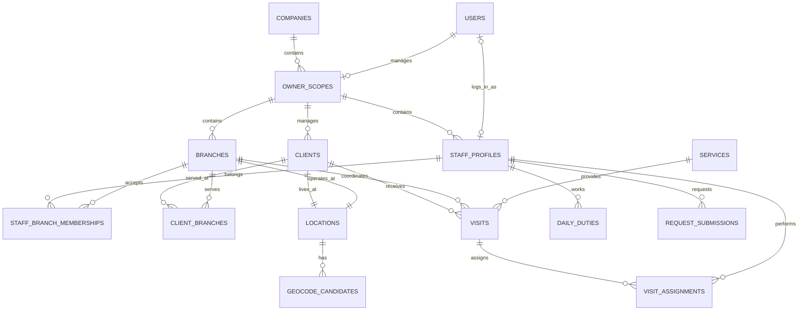

# 訪問のアトリエ Web版 データとAPI設計書

作成日：2026年10月4日  
版：初期設計 0.2

以下は目標のデータ・API仕様です。Web版0.1.0の実装済み機能と差分は[実装状況](IMPLEMENTATION_STATUS.md)に記録しています。

本書は[基本設計書](../DESIGN.md)と[技術設計書](TECHNICAL_DESIGN.md)の具体的なデータ構造、API、実装順序、受入条件を定めます。以下は論理設計であり、DDL・OpenAPIの実装そのものではありません。

## データ設計の共通規則

- 主キーはUUID。業務テーブルには `company_id` と `scope_id` を付ける。scope_idはオーナーの管理範囲を表す。
- 営業所固有の予定には `branch_id` を付ける。スタッフ本人・希望・総勤務時間・雇用条件は営業所ごとに複製しない。
- 編集可能な集約は `version integer NOT NULL DEFAULT 1`、`created_at`、`updated_at`、必要な登録者・更新者IDを持つ。
- 日時の型と解釈は技術設計書に従う。金額は整数の円または固定小数で保存し、浮動小数を使用しない。
- 空の外部キーはNULLで表し、空文字を使わない。マスターの無効化は `is_active`、アカウントはstatusで表す。
- 業務で必要な関連は関係テーブルへ正規化する。JSONBは履歴の固定表示内容、ジョブ結果、限定された設定に用いる。
- 履歴から参照されるスタッフ・営業所・顧客・業務は無効化を基本とし、通常画面から連鎖して物理削除しない。
- UNIQUEやFKの列順を揃え、通常の業務参照は `(company_id, scope_id, id)` を使用する。

## 主な関連

関連図のlocationsは一件ごとに顧客用または営業所用のどちらかです。同じ座標でも別の顧客は別locationを持ちます。共通の住所だからという理由で別人や別管理範囲を統合しません。

## 認証と会社と管理範囲

| テーブル | 主な列 | 制約と用途 |
| --- | --- | --- |
| companies | id、name、contact、timezone、status、version | 会社情報。timezoneの初期値はAsia/Tokyo |
| users | id、login_id_normalized、display_name、role、password_hash、email、status、auth_version | login_id一意。roleはsystem_admin、owner、member。password_hashは初回設定前のみNULL |
| owner_scopes | id、company_id、owner_user_id、name、status、default_travel_minutes | owner_user_idは一意。一人のオーナーは一つの管理範囲を管理する初期案 |
| schedule_state | company_id、scope_id、revision | scopeごとに一行。検証に関わる変更のロックと候補作成の版管理 |
| auth_sessions | id、token_hash、user_id、csrf_token_hash、issued_at、last_seen_at、expires_at、revoked_at、auth_version | token_hash一意。生のセッションIDをDBへ保存しない |
| account_setup_tokens | id、user_id、token_hash、purpose、expires_at、consumed_at、issued_by | 初回設定・再設定。purposeを混用しない |
| auth_attempt_counters | key_hash、window_start、attempt_count、blocked_until | 複数APIプロセス間でログイン回数制限を共有する |

usersはログイン識別子を管理する全体テーブルです。所属会社と管理範囲は、オーナーならowner_scopes、メンバーなら紐付いたstaff_profilesから取得します。usersに別のcompany_id・scope_idを重ねて持たせ、所属情報が食い違う構造にしません。

システム管理者は業務範囲への所属を不要とします。memberの有効アカウントにはstaff_profilesを必須とし、ownerの有効アカウントにはowner_scopesを必須とします。staff_profilesのuser_idは全体一意で、owner本人が勤務する場合も自分の管理範囲のプロフィールだけへ紐付けます。

roleと紐付け先の整合性は登録・変更Serviceで確認し、整合性用の遅延制約トリガーでもcommit時に検証する方針です。member登録はアカウント・プロフィール・所属営業所を一つのトランザクションで作ります。通常のプロフィール編集からuser_idやroleを自由に変更することは許可しません。

オーナー交代ではowner_scopesのowner_user_idを変更し、旧・新オーナーのセッションを失効させます。旧オーナーの扱いは停止またはメンバー化を明示し、所属・本人プロフィールとの整合を同じトランザクションで解決します。

## 営業所とスタッフ

| テーブル | 主な列 | 制約と用途 |
| --- | --- | --- |
| branches | id、company_id、scope_id、code、name、office_location_id、phone、is_active | codeはscope内一意。office_location_idは営業所用location |
| staff_profiles | id、company_id、scope_id、user_id NULL、name、job、qualification_tags、primary_branch_id、max_visits_per_day、is_active | user_idは一意。jobはケアマネ・ヘルパー・兼務など |
| staff_branch_memberships | id、company_id、scope_id、staff_id、branch_id、valid_from、valid_until NULL | 同じスタッフと営業所の所属期間が重ならない |
| staff_weekly_duties | id、company_id、scope_id、staff_id、weekday、off、start_time、end_time、break_start、break_end、depart_branch_id、return_branch_id | staff_idとweekdayで一意。勤務は全営業所共通 |
| staff_pay_terms | id、company_id、scope_id、staff_id、effective_from、employment_type、pay_type、amount、changed_by | staff_idとeffective_fromで一意。次の開始日の前日まで有効 |
| staff_services | company_id、scope_id、staff_id、service_id | 複合主キー。対応できる業務の関係 |
| services | id、company_id、scope_id、name、allowed_jobs、required_qualification_tags、default_minutes、required_people、is_active | カスタム業務を登録可能。資格タグは正規化した文字列で照合 |

staff_branch_membershipsのvalid_untilは終了日を含みます。日付を判定する際は `valid_from <= 対象日` かつ `valid_until IS NULL OR 対象日 <= valid_until` を用います。DBではdaterangeと排他制約を使い、同じstaff_id・branch_idの期間重複を防ぐ方針です。必要なbtree_gist拡張の導入をマイグレーションに含めます。

別営業所の所属期間が重なることは許可します。primary_branch_idは同じ管理範囲で、現時点で有効な所属先から選びます。主所属の変更は過去訪問の営業所を書き換えません。

max_visits_per_dayなどの上限は全営業所合算です。スタッフの無効化・所属終了は将来の有効な訪問を検証し、未解決の担当が残る場合は409を返します。

## 顧客と所在地と移動

| テーブル | 主な列 | 制約と用途 |
| --- | --- | --- |
| clients | id、company_id、scope_id、name、display_label、location_id、phone、primary_branch_id、visit_guide、private_note、weekdays、available_start、available_end、is_active | 主担当営業所と訪問可能営業所を分ける。visit_guideは担当メンバー向け |
| client_branches | company_id、scope_id、client_id、branch_id、is_active | 同一顧客を複数営業所から支援するための関係 |
| client_staff_preferences | company_id、scope_id、client_id、staff_id、relation | relationはcare_manager、regular、backup。業務に対応可能かは別途検証 |
| locations | id、company_id、scope_id、kind、postal_code、prefecture、municipality、street_address、building_room、address_text、address_revision | kindはclientまたはoffice。原住所と検索用構成を保持 |
| locationsの位置情報 | latitude NULL、longitude NULL、geocode_status、coordinate_source、provider、provider_feature_id、accuracy、geocoded_at、verified_at、verified_by、geometry_version、valid_address_revision | 有効座標は現在の住所版に結び付ける |
| geocode_candidates | id、company_id、scope_id、location_id、job_id、address_revision、geometry_version、rank、latitude、longitude、formatted_address、accuracy、provider | 確認待ち候補。候補を選択する時にも住所・座標版を確認 |
| travel_times | id、company_id、scope_id、from_location_id、to_location_id、from_address_revision、to_address_revision、minutes、version | 初期版は往復共通。地点IDの順を正規化して一意にする |

latitudeは `numeric(9,6)`、longitudeは `numeric(10,6)` とし、緯度は-90〜90、経度は-180〜180をCHECKで制限します。両方NULLまたは両方非NULLとし、緯度だけ保存することは許可しません。小数桁数は保存形式であり、取得位置がその精度で正しいことを意味しません。

geocode_statusは `unset / queued / running / resolved / needs_review / not_found / failed / stale`、coordinate_sourceは `provider_auto / provider_confirmed / manual` とします。有効位置はresolvedかつvalid_address_revisionが現在値に一致するものだけです。未確定候補を顧客の現在位置へコピーしません。

住所変更時は公開用のlatitude・longitudeをNULLへ戻し、旧座標が必要なら権限付きの変更履歴へ記録します。手動位置の変更でもgeometry_versionを増やします。建物・部屋情報だけの修正と検索用住所の変更を区別し、検索に影響する変更だけaddress_revisionを増やします。

locationsは必ず同じ管理範囲の顧客または営業所一件に結び付きます。kindと参照先の整合・二重参照はServiceと制約トリガーで検証します。移動時間の参照元住所版が変わった場合は登録分数を要確認にし、検証では標準分数へ戻して推定表示します。

## 希望と勤務と訪問

| テーブル | 主な列 | 制約と用途 |
| --- | --- | --- |
| request_windows | id、company_id、scope_id、target_month、opens_at、deadline_at、status | scopeとtarget_monthで一意。営業所別に本人の希望を重複募集しない |
| request_submissions | id、company_id、scope_id、window_id、staff_id、status、submitted_at、returned_reason、version | window_idとstaff_idで一意。draft、submitted、returned |
| request_days | id、company_id、scope_id、submission_id、date、kind、preferred_branch_id NULL、note | submission_idとdateで一意。available、unavailable、prefer_off |
| request_intervals | id、company_id、scope_id、request_day_id、start_time、end_time | availableの日の希望時間帯。複数時間帯を許し、重なりを拒否 |
| daily_duties | id、company_id、scope_id、staff_id、date、off、start_time、end_time、break_start、break_end、depart_branch_id、return_branch_id、status、latest_publication_id、version | staff_idとdateで一意。draft、published。営業所横断で一日の勤務を一件管理 |
| duty_publications | id、company_id、scope_id、duty_id、staff_id、publication_no、snapshot、published_at、published_by | 公開時の内容。勤務変更時にも直前の公開内容を残す |
| staff_blocks | id、company_id、scope_id、staff_id、date、start_time、end_time、kind、location_id NULL、note | 会議・内勤は営業所の所在地を明示。休憩は移動可能時間から除く |
| recurring_series | id、company_id、scope_id | 同じ定期訪問を継続して識別するID |
| recurring_rules | id、company_id、scope_id、series_id、branch_id、client_id、service_id、mode、weekdays、due_day、start_time、duration_minutes、required_people、valid_from、valid_until、version | 同一seriesの有効期間が重ならない。weeklyまたはmonthly |
| recurring_rule_staff | company_id、scope_id、rule_id、staff_id | 担当候補。訪問日ごとの所属と勤務条件は生成・割当時に検証 |
| visits | id、company_id、scope_id、branch_id、client_id、service_id、date NULL、start_time、duration_minutes、required_people、earliest_date、deadline_date、status、locked、series_id NULL、occurrence_key NULL、anchor_date、is_exception、note、latest_publication_id、version | 一件の訪問。draft、confirmed、done、cancelled |
| visit_assignments | company_id、scope_id、visit_id、staff_id | visit_idとstaff_idで一意。同じ人を二人分として配置しない |
| visit_publications | id、company_id、scope_id、visit_id、publication_no、publication_status、snapshot、published_at、published_by | 公開時の日時・営業所・業務・配布名を固定。公開データの履歴 |
| publication_assignees | company_id、scope_id、publication_id、staff_id | メンバーの公開予定をSQLで本人に絞るための関係 |
| member_schedule_notices | id、company_id、scope_id、staff_id、visit_id NULL、kind、summary、created_at、read_at | 再調整・担当解除・中止等。本人向けに必要な変更だけ表示 |

### 所属と公開の検証

visitsのbranch_idとclient_idは同じ管理範囲かつ有効なclient_branchesの組合せにします。担当スタッフはその営業所への所属が訪問日に有効でなければなりません。日付未定の訪問では、調整期間と所属期間が交差する候補だけを割り当て、日付決定時に再検証します。

メンバーの勤務希望は本人のstaff_idに固定します。preferred_branch_idも有効所属先だけを受け付けます。締切後の編集や提出済みの直接書換えは、APIから呼び出しても拒否します。

訪問公開には対象スタッフ全員の日別勤務の公開が必要です。標準勤務だけが存在する場合、公開操作のプレビューで対象日の日別勤務を作成・公開することを示し、訪問と同じトランザクションで保存できます。月全体の公開も同じ条件を一括適用します。

公開snapshotは任意のORM情報を丸ごとJSON化しません。公開用スキーマを使い、費用・管理メモ・ログイン情報を含めません。所在地・電話・訪問案内はsnapshotに固定せず、詳細APIで現在の担当と所属を検証して取得します。別のメンバーへ担当変更した後、旧担当者に現在の顧客詳細を返しません。

再調整へ戻した場合、latest_publication_idは直前の公開を参照し、メンバーの画面では「再調整中」と表示します。再確定時に新しいpublicationを作り、担当を外れた人には住所を含まない担当解除のお知らせを作ります。過去の公開版一覧をメンバーから任意検索するAPIは作りません。

### 定期発生キー

scope内でoccurrence_keyを一意にし、NULLの手動訪問は複数許可します。毎週型は `series_id + 元の対象日`、月1回型は `series_id + 対象月` を材料に生成します。表示中の日付、担当営業所、担当者をキーに含めません。

日付・担当・営業所を変えても発生キーを保持して個別変更扱いにします。中止レコードにも発生キーを残します。ルールの将来改訂では通常の未確定・未固定・例外なしの訪問だけを対象とし、再生成と保存を一つのトランザクションにします。

単発訪問の調整期間が元々一日の場合、別日への移動に合わせてその一日枠を変更できます。月単位の期限がある訪問は期限を自動で広げず、範囲外なら確認事項として返し、期限変更を別途明示します。

## ジョブと履歴と取り込み

| テーブル | 主な列 | 用途 |
| --- | --- | --- |
| jobs | id、company_id、scope_id、requested_by、kind、status、dedupe_key、target_id、payload、result、attempts、next_run_at、lease_token、lease_until、progress、error_code、created_at | geocode、allocation、import等。scopeとdedupe_keyで重複登録を防止 |
| api_idempotency | id、user_id、scope_id、route、key、request_hash、status、response_reference、expires_at | キー再利用と通信再試行を管理。異なる内容で同じキーは409 |
| change_events | id、company_id、scope_id、actor_user_id、action、entity_type、entity_id、changed_fields、before_values、after_values、created_at | 変更履歴。認可された項目だけ保存・表示 |
| import_batches | id、company_id、scope_id、branch_id、source_hash、source_schema、status、counts、created_by | 取り込み対象と件数を確定し、重複実行を防ぐ |
| imported_entity_ids | company_id、scope_id、batch_id、entity_type、source_id、target_id | 旧IDと新UUIDの対応。同姓同名での推測統合を防ぐ |

ジョブのpayloadは種類ごとのスキーマで検証し、任意コードや任意接続先を保持しません。住所検索ジョブはlocation_id、address_revision、geometry_version、provider設定の版を持ち、氏名や連絡先の複製を含めません。

外部APIの一時的な障害と認可不足を分け、失効した依頼者のジョブを無条件に実行しません。ジョブの一覧・進捗・結果は作成時と同じscopeで認可し、ジョブIDを知っているだけでは取得できないようにします。

## DBの制約と索引

### 参照整合性

owner_scopesに `UNIQUE(company_id, id)`、通常の業務マスターに `UNIQUE(company_id, scope_id, id)` を設けます。子テーブルからはこの組合せへFKを張り、別会社・別オーナー範囲のIDを混在させる更新をDBでも拒否します。

client_branchesには `(company_id, scope_id, client_id, branch_id)` の一意制約を置き、訪問が指す顧客と営業所の関係を確認できます。所属の有効日、roleとの関係、人数、複数テーブルをまたぐ時間検証はCHECKだけでは扱えないため、Serviceで検証します。更新競合への対策はscope単位の行ロックとversionを組み合わせます。

以下のDB制約も設けます。

- 所要時間・必要人数は正の値、移動分数・費用・上限は規定範囲内。
- 勤務日のstart_timeはend_timeより前、休憩の開始と終了は両方ありまたは両方なし。休みの日は勤務・休憩時刻をNULLにする。
- earliest_dateはdeadline_date以前。confirmedとdoneの訪問は日付必須とし、日程未調整の訪問を中止するcancelledではNULLを許可する。
- 同一訪問への同一スタッフ重複、同一日の勤務重複、同一月の本人希望重複を禁止。
- 所属期間と定期ルールの版の期間重複を排他制約で拒否。
- visitsの有効なoccurrence_key、publicationsの対象とpublication_noの組合せを一意にする。

時間が重複する仮予定は業務上保存できるため、すべてのvisit_assignmentsに一律の時間排他制約を設定しません。確定可否の判定は、技術設計書に記したロック下の再検証で保証します。

### 主要索引

| 対象 | 索引の例 |
| --- | --- |
| 予定表 | visits(scope_id, date, start_time)、visits(scope_id, branch_id, date) |
| 未調整 | visits(scope_id, status, deadline_date)、必要に応じて未調整用部分索引 |
| 担当者 | visit_assignments(scope_id, staff_id, visit_id) |
| 営業所所属 | staff_branch_memberships(scope_id, staff_id, branch_id, valid_from) |
| 公開予定 | publication_assignees(scope_id, staff_id, publication_id) |
| 顧客検索 | clients(scope_id, primary_branch_id, is_active)、配布名検索用索引 |
| 地図 | locations(scope_id, geocode_status)、latitude・longitudeの範囲検索用索引 |
| 希望と勤務 | request_submissions(scope_id, window_id, staff_id)、daily_duties(scope_id, staff_id, date) |
| ジョブ | jobs(status, next_run_at)、jobs(scope_id, requested_by, created_at) |
| 履歴 | change_events(scope_id, entity_type, entity_id, created_at) |

実データに近い件数で実行計画を確認して追加します。地図の範囲検索が数値列の索引で十分かも負荷試験で判断します。

## APIの共通仕様

ベースURLは `/api/v1`。JSONの項目名はsnake_case、UUIDは文字列、更新日時はISO 8601です。認証はCookieとCSRFトークンを使用します。業務更新の入力に未知の項目があれば原則422で拒否します。

管理用の業務APIは `/scopes/{scope_id}` の下に置きます。システム管理者と、そのscopeを管理するオーナーが利用できます。メンバー用は `/me` に分け、staff_idやscope_idを指定して他人へ切り替えられないようにします。

一覧には期間・ページサイズの上限を設けます。予定一覧の一回の期間は最大93日、メンバーの地図は最大31日を初期値とします。通常の一覧はcursor方式、件数上限100件。地図はbboxとzoomに応じたクラスタと、認可済みの全体件数・要確認件数を返します。

| ステータス | 意味 |
| --- | --- |
| 200・201・204 | 取得・更新成功、新規作成、応答本文なしの成功 |
| 202 | 非同期ジョブを受理。job_idと状態取得先を返す |
| 401 | 未ログイン・セッション失効 |
| 403 | ロールとして許可されていない操作、CSRF検証失敗 |
| 404 | 存在しないID、または参照できない範囲のID |
| 409 | version競合、状態遷移不整合、使用中の所属削除、Idempotency-Keyの内容不一致 |
| 422 | 入力不正、確定条件を満たさない等の業務エラー |
| 429・503 | 利用回数上限、一時的な利用不可。再試行可能かを返す |

エラー形式は `error.code`、`error.message`、`error.fields`、`error.issues`、`request_id` を共通化します。issuesには認可された対象IDだけを含めます。管理範囲外の顧客名や担当者名をエラーの説明から漏らしません。

## 認証と管理のAPI

| メソッドとパス | 内容 | 権限 |
| --- | --- | --- |
| GET /auth/csrf | 事前セッションとCSRFトークンを取得 | 未ログイン可 |
| POST /auth/login | ログインしセッションを更新 | 未ログイン可 |
| POST /auth/logout | 現在のセッションを失効 | 本人 |
| POST /auth/password | 現在のパスワードを確認して変更 | 本人 |
| POST /auth/setup | 有効な初回・再設定トークンでパスワード設定 | トークン保有者 |
| GET /auth/me | 本人のrole、許可scope、営業所、公開用プロフィール | 本人 |
| GET・POST /admin/companies | 会社一覧・新規作成 | 管理者 |
| GET・PATCH /admin/companies/{id} | 会社詳細・基本情報・停止状態 | 管理者 |
| POST /admin/owners | 会社にオーナーと管理範囲を作成 | 管理者 |
| POST /admin/scopes/{id}/transfer-owner | オーナー交代 | 管理者 |
| GET /admin/users | ユーザーの横断検索 | 管理者 |
| GET /admin/operations | ジョブ失敗、地図利用状況、運用状態 | 管理者 |
| GET・PATCH /company | 所属会社の基本情報 | オーナー |

メンバーは `/auth/me` に自分の勤務に必要な会社・営業所表示名だけを受け取ります。 `/company` の管理用DTOは使用しません。

## オーナーと管理者の業務API

以下のパスには `/scopes/{scope_id}` を付けます。リストのGET・POSTに加え、編集対象には原則 `GET・PATCH /{resource}/{id}` を用意します。無効化はstatusまたはis_activeの更新として扱います。

| メソッドとパス | 内容 |
| --- | --- |
| GET・POST /branches | 営業所一覧・作成 |
| GET・POST /staff | スタッフ情報。ログインのないスタッフも登録可 |
| POST /owner-profile | オーナー本人専用。StaffInputで本人スタッフを新規作成し、同一トランザクションでuser_idを紐付ける |
| POST /owner-profile/link | オーナー本人専用。staff_id・expected_versionで既存の有効な未連携スタッフを本人に設定 |
| POST /members | メンバーアカウントとスタッフ・所属を作成、または既存スタッフへ発行 |
| PATCH /members/{id} | メンバーの表示情報・停止。roleとscopeの自由変更は不可 |
| POST /members/{id}/setup-token | 初回・再設定リンクの再発行 |
| GET・POST /staff/{id}/memberships | 営業所への所属履歴と追加 |
| PATCH /staff/{id}/memberships/{membership_id} | 所属期間変更。将来予定との整合確認 |
| GET・PUT /staff/{id}/weekly-duties | 標準勤務の取得・更新 |
| GET・POST /staff/{id}/pay-terms | 適用日別の雇用・費用条件 |
| GET・POST /services | 業務マスター |
| GET・POST /clients | 顧客。営業所・対応スタッフ・訪問条件も同じユースケースで更新 |
| GET・POST /request-windows | 希望募集と締切 |
| GET /request-windows/{id}/submissions | 提出状況と内容 |
| POST /request-submissions/{id}/return | 差し戻し |
| PUT /staff/{id}/requests/{month} | 本人の希望を代行入力。変更者はオーナーまたは管理者を記録 |
| POST /staff/{id}/requests/{month}/submit | expected_versionを指定して代理提出。本人にアプリ内のお知らせを追加 |
| POST /staff/{id}/requests/{month}/withdraw | expected_versionを指定して締切前に代理取り下げ |
| GET・PUT /duties/{staff_id}/{date} | 日別勤務の取得・保存 |
| POST /duties/{staff_id}/{date}/publish | 日別勤務を公開 |
| GET・POST /blocks | 会議・内勤・休憩 |
| GET・POST /visits | 訪問一覧と作成 |
| PATCH /visits/{id}/position | ドラッグによる日時・行の変更 |
| POST /visits/{id}/confirm | 関連検証後に確定し公開版を作成 |
| POST /visits/{id}/reopen | 再調整へ戻す。公開済みの本人に再調整中と通知 |
| POST /visits/{id}/complete | 完了の記録 |
| POST /visits/{id}/cancel | 中止。発生キーと公開履歴を保持 |
| GET /schedule/issues | 期間と営業所で表示を絞った確認事項。検証自体は全営業所 |
| POST /schedule/publish | 選択勤務・訪問の一括公開。関連エラーがあれば全体を拒否 |
| GET・POST /recurring-rules | 定期訪問ルール |
| POST /recurring-rules/{id}/revise | 適用開始日からの版改訂 |
| POST /recurring-visits/generate | 対象月の重複しない訪問生成 |
| POST /allocation-jobs | 自動調整の候補作成 |
| POST /allocation-jobs/{id}/apply | scopeのrevisionを再確認して候補適用 |
| GET・PUT /travel-times | 地点間の移動分数 |
| GET /reports/summary | 件数・時間・任意の概算費用 |
| GET /exports/schedule.csv | 権限と出力項目を限定したCSV |
| POST /imports/preview | 旧JSONの検証と件数プレビュー |
| POST /imports/{id}/apply | 空の移行先へ一括適用 |
| GET /jobs/{id} | ジョブ状態・結果 |
| GET /history | 自分の範囲の業務変更履歴 |

### 本人登録と代理入力の実装契約

本人スタッフは既存のuser_idの一意制約を使い、一つのオーナーアカウントに一つだけ登録します。通常のStaffInputではuser_idを受け付けず、本人専用APIで役割・管理範囲・未登録を検証します。他人のアカウントの付け替えは許可しません。既存スタッフとの紐付けは版チェック後にuser_idだけを変更し、履歴を追加します。新規作成と紐付けはscopeのロックで同時操作を直列化します。今回の追加にDBマイグレーションは不要です。

本人入力と代理入力はAvailabilityServiceで期限・日付・重複・版・提出状態を共通検証します。代理入力のactorを対象スタッフへ差し替えず、History.actor_idには実際のログインユーザーを保存します。本文のstaff_id・scope_id・role追加は422で拒否します。提出済みの編集は409、他オーナーのscopeは403、scope内にないスタッフIDは404です。差し戻し時は理由を必須とし、差し戻し後のみ締切後の修正・再提出を許可します。

### ドラッグ保存の契約

リクエストにはexpected_version、display_group、target_date、必要ならtarget_start、移動元と移動先の行IDを送ります。display_groupがstaffならsource_staff_idとtarget_staff_id、clientならsource_client_idとtarget_client_idを使います。branch_id変更はposition APIに含めず、通常の訪問編集で行います。

Serviceは対象が仮予定であること、移動元が現在の担当者・顧客と一致することを確認します。複数人訪問は移動元の一人だけ差し替えます。担当未定の行からは不足分に追加し、担当未定への移動は対象一人を外します。すでに担当している人を二人目として追加する操作は拒否します。

返却は更新後のvisit、version、schedule_revision、対象に関するissuesです。初期版のローカルな楽観表示は可能ですが、成功応答の内容で確定し、409や失敗で元に戻します。クライアントのチェック結果だけで保存・確定を許可しません。

## 本人用API（メンバー・本人スタッフ登録済みのオーナー）

本人スタッフが有効なオーナーも以下の実装済みAPIを利用できます。メンバーと同じく本人情報だけを返し、オーナーの管理権限と役割は維持します。オーナー画面の未公開訪問の編集には通常の管理用APIを使います。

| メソッドとパス | 内容 |
| --- | --- |
| GET /me/schedule | 自分の全営業所の公開勤務・担当訪問、再調整中の表示 |
| GET /me/visits/{id} | 自分の公開済み担当訪問の詳細。現在の権限で住所・電話・案内を組み立てる |
| GET /me/request-windows | 自分の希望募集と締切 |
| GET・PUT /me/requests/{month} | 自分の希望の取得・下書き保存 |
| POST /me/requests/{month}/submit | 締切と入力を検証して提出 |
| POST /me/requests/{month}/withdraw | 締切前に取り下げ |
| GET /me/visit-map | 自分の担当訪問先だけの地図 |
| GET /me/notices | 自分の予定変更のお知らせ |
| POST /me/notices/{id}/read | 自分のお知らせを既読にする |

メンバー用の入力型にはstaff_id・scope_id・role・pay_terms・visit_assignmentsを含めません。指定されても無視せず422で拒否します。営業所フィルターは本人の許可された所属先だけを受け付けます。営業所未指定では本人の全所属を対象とし、全メンバーへ広げません。

## 位置取得と地図のAPI

以下の管理用パスには `/scopes/{scope_id}` を付けます。システム管理者とオーナーが操作します。

| メソッドとパス | 内容 |
| --- | --- |
| PATCH /locations/{id}/address | 住所更新・旧座標無効化・位置取得ジョブ登録を一括実行 |
| POST /locations/{id}/geocode | 未取得・失敗した住所の位置取得を再依頼 |
| GET /locations/{id}/geocoding | 現在の住所版に対する状態と候補 |
| POST /locations/{id}/geocoding/confirm | candidate_id、address_revision、geometry_versionを検証して採用 |
| PATCH /locations/{id}/coordinates | 緯度・経度の手入力またはピン移動。位置の版を更新 |
| POST /geocoding/batches | 未取得などの対象を指定し、件数確認後にまとめて取得 |
| GET /maps/clients | 営業所・担当者・訪問日等で絞った全顧客地図 |
| GET /maps/branches | 管理範囲の営業所地図 |

顧客や営業所の初回登録ではlocation作成と同じService内でジョブを登録します。地図の閲覧だけでは位置検索を再実行しません。メンバーの `/me/visit-map` から管理用の全顧客検索へ転送して広いデータを返す実装は禁止します。

地図レスポンスには `features`、`bounds`、`matched_count`、`resolved_count`、`needs_review_count` を含めます。GeoJSONのgeometryと公開用のpropertiesだけを返し、費用・管理メモ・他人の所属情報を混ぜません。クラスタの件数は表示権限がある顧客だけで計算します。

## デスクトップ版からの取り込み

schema 4のcare領域を初期対象にします。旧schema 1〜3はエラー内容を示し、デスクトップ版で更新・書出ししたデータを使うか、後続の専用変換で扱います。旧店舗向け領域を勝手に破棄・訪問へ変換しません。

取り込み先は会社・scope・営業所を一つ指定し、業務データがない管理範囲を対象にします。既存の初期業務マスターは明示した対応表で処理します。スタッフ、顧客、業務、ルール、訪問、勤務、休憩、移動、費用条件を新UUIDへ対応付けます。参照切れ・無効時間・発生キー重複を検出し、適用時にエラーが一件でもあれば全件rollbackします。

ログインアカウントは別途発行します。全員を同じパスワードで自動作成することはしません。位置情報がない顧客は未取得とし、取込完了後に対象件数を確認して位置取得バッチを実行します。

## 実装順序

| 段階 | 実装するもの | 段階の完了条件 |
| --- | --- | --- |
| 1 | Python 3.14環境、FastAPIの層分離、PostgreSQL、Alembic、ログイン、3ロール、会社・scope | 他会社・別オーナーのデータを取得・更新できない |
| 2 | 営業所、スタッフ、メンバー登録、複数所属、業務、顧客、雇用条件 | 一人のスタッフを複数営業所へ所属させ、履歴付きで管理できる |
| 3 | 勤務希望、日別勤務、訪問表、ドラッグ、全営業所の条件検証、公開 | メンバー提出からオーナー調整、本人確認まで通る。同時確定の衝突を防げる |
| 4 | 定期生成、自動調整、所在地、位置取得ワーカー、地図、訪問案内 | 定期生成の重複を防ぎ、住所変更・手修正・権限付き地図を扱える |
| 5 | 集計、CSV・印刷、旧JSON移行、バックアップ、リリースと移行手順 | 本番相当環境で一連の受入試験と復旧試験を通す |

段階4の地図接続部は先にテスト用の提供者で検証できます。実際の住所を外部送信する機能は、提供者・契約・キー・利用上限の設定後に有効化します。今回の設計作成では外部への住所送信やサービス契約は行いません。

## 受入条件

| 分類 | 検証する条件 |
| --- | --- |
| 会社分離 | 会社Aのオーナーが会社BのIDをURL・本文・フィルターへ入れても一覧・詳細・更新・CSV・地図から情報を得られない |
| オーナー分離 | 同じ会社の別オーナーが登録したメンバー・顧客を取得できない。集計やクラスタ件数からも漏れない |
| 管理者権限 | 管理者は全会社へアクセスできるが、DB参照整合性や確定チェックは省略できない |
| 管理者による登録 | 管理者がオーナーAを指定して登録したメンバーはAが管理でき、Bは管理できない |
| 複数所属 | 同じメンバーが営業所1・2に所属でき、本人画面に両方の予定が一度ずつ出る |
| 営業所横断 | 営業所を絞った画面でも、別営業所の同一人物の予定との重複・移動不足を検出する |
| 所属の終了 | 終了日後の既存訪問を放置して所属終了できない。終了後は本人へ顧客住所を返さない |
| メンバー入力 | 自分の希望だけを編集でき、他人のID指定・role改変・予定確定の直接API呼出しを拒否する |
| 希望の締切 | 未提出、提出済み、差し戻し、締切後の状態に応じた入力制限を画面とAPIで一致させる |
| 公開 | 未公開の予定・費用・管理メモがメンバー応答に含まれない。再調整・中止・担当解除が本人に分かる |
| 同一カードの競合 | 同じversionで二回保存すると後の要求が409となり、先の変更を消さない |
| 異なるカードの競合 | 別々の訪問を同じスタッフへ同時確定しても、後の処理で最新の重複を検知する |
| 複数人訪問 | 一件の訪問として数え、同じスタッフを二人分に数えず、ドラッグした一人だけ差し替える |
| 定期生成 | 日付・営業所を移した訪問や中止を再生成しない。月末期限を正しく扱う |
| 時間と費用 | 営業所横断で勤務時間を二重計上せず、条件変更の適用日前後を正しく計算する |
| 自動位置取得 | 住所保存で一件のジョブを作り、有効な座標を取得・保存し、再表示で再検索しない |
| 位置候補 | 複数候補・町域だけの結果・該当なし・通信失敗を区別し、誤った候補を確定位置として表示しない |
| 住所変更の競合 | 古い住所の応答が後から来ても新住所の位置を上書きしない。旧座標を経路案内へ使わない |
| 手動修正の競合 | ワーカー実行中にピンを修正しても、遅れた自動取得で手動位置が消えない |
| 地図の本人制限 | メンバーの地図・詳細・クラスタ・件数には本人の担当訪問だけを含める |
| ジョブ障害 | プロセス再起動で未完了ジョブを回収できる。429や一時障害で無限再試行しない |
| セッション | アカウント停止・再設定・役割変更で旧セッションを失効し、他人の初期設定トークンを発行できない |
| DB保護 | 複合FK、RLS、接続プールの文脈リセットが実PostgreSQLで機能し、別scopeの関係を保存できない |
| マイグレーション | 空DBと前バージョンDBの両方で更新でき、失敗時に新アプリを公開しない。バックアップから復旧できる |
| 旧データ取込 | 取込件数が一致し、壊れた参照・重複実行を拒否する。既存デスクトップDBを変更しない |
| 操作性 | PCで日・週表示とドラッグ、スマートフォンで勤務希望・担当訪問・地図の確認ができる |
| デザイン継承 | [UI設計書](UI_DESIGN.md)の基準に従い、PC画面を既存アトリエと比較する。スマートフォンと長い日本語でも文字切れ・操作の重なりがなく、新設のログイン・地図画面も同じデザインで揃う |

## 設計時点での確認事項

追加の要望がなければ、本書に記した初期案で実装できます。ただし次の項目は、採用判断が必要な事項として残します。

1. メンバーの入力範囲を勤務希望とするか、自分の訪問予定の作成まで広げるか。広げる場合は新しい申請・承認と編集可能範囲を定義する。
2. 異なるオーナーや会社の営業所にまたがる兼務を許すか。許す場合は、明示的な共有関係と非公開予定を含む重複検知を追加する。
3. 永続保存と複数会社向け表示に合う地図サービス、契約、料金上限。
4. 本番の設置先・ドメイン・バックアップ保管先。運用目標は負荷・復旧試験後に確定する。
