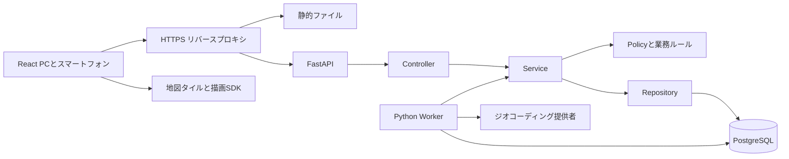
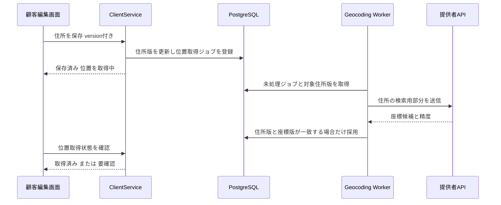

# 訪問のアトリエ Web版 技術設計書

作成日：2026年10月4日  
版：初期設計 0.2

以下は目標の構成です。Web版0.1.0の実装済み機能と差分は[実装状況](IMPLEMENTATION_STATUS.md)に記録しています。

本書は[基本設計書](../DESIGN.md)を実装するための構成、責務、認証、同時編集、地図連携、運用方式を定めます。採用技術は指定に従い、追加するライブラリやサービスは実装候補として明記します。

## 技術構成

| 領域 | 採用方針 |
| --- | --- |
| 実行環境 | Python 3.14.x の通常ビルド |
| API | FastAPI、Pydantic v2、Uvicorn |
| ORM | SQLAlchemy 2.x の型付きモデルと Session |
| DB接続 | Psycopg 3、`postgresql+psycopg` |
| DB | PostgreSQL 18.x を初期候補とする |
| スキーマ更新 | Alembic |
| フロントエンド | React、TypeScript、Vite。[UI設計書](UI_DESIGN.md)に従い、既存アトリエの色・書体・配置・共通部品を継承 |
| 画面遷移と取得状態 | React Router、TanStack Queryを候補とする。APIのOpenAPIから型を生成 |
| 地図 | 地図描画とジオコーディングの接続部を分離。Mapboxは候補であり契約確認後に確定 |
| 非同期処理 | PostgreSQLのジョブテーブルと別Pythonワーカープロセス |
| 認証 | PostgreSQLに保管するサーバーセッション、HttpOnly Cookie |
| 構成管理 | `pyproject.toml` とロックファイル、`package-lock.json` |
| 開発 | Windows上のフロントエンド・APIと、Docker ComposeのPostgreSQLを基本案とする |
| 本番 | HTTPSリバースプロキシ、静的フロントエンド、API、ワーカー、PostgreSQL |

FastAPIの公式リリースノートにはPython 3.14対応が記録され、Pydantic v1はPython 3.14以降の対応対象外と説明されています。この構成ではPydantic v2を使用します。[FastAPIリリースノート](https://fastapi.tiangolo.com/release-notes/)

SQLAlchemyの更新履歴にはPython 3.14の型注釈対応が含まれ、Psycopgの公式対応範囲にも3.14が含まれています。ただし、この設計段階で特定の組合せを動作検証したとは扱いません。実装開始時に安定版のパッチバージョンを固定し、Python 3.14でインストール・接続・マイグレーション・テストを確認します。開発版の文書が表示される場合も、開発版パッケージを自動採用しません。[SQLAlchemy更新履歴](https://docs.sqlalchemy.org/en/20/changelog/changelog_20.html)、[Psycopg対応環境](https://www.psycopg.org/psycopg3/docs/basic/install.html)

PostgreSQLはサポートされるメジャーバージョンを使い、対応する更新版を適用します。本番環境に制約がある場合も、実装・CI・本番で同じメジャーバージョンを使用します。[PostgreSQLサポート方針](https://www.postgresql.org/support/versioning/)

## システム構成



ブラウザーからの業務APIは同一オリジンの `/api/v1` に統一します。PostgreSQLへの接続情報と位置取得用のサーバーキーはバックエンドだけが持ちます。地図描画に公開トークンが必要な場合は、用途と対象ドメインを制限した別トークンをフロントエンドへ渡します。

## 層ごとの責務

| 層 | 責務 | 持たせない処理 |
| --- | --- | --- |
| Controller | APIRouter、入力形式の検証、認証済みActorの取得、Service呼出し、HTTP応答 | SQL、確定条件、担当者選定、DBコミット |
| Service | ユースケース、権限判定の呼出し、業務条件、トランザクション、変更履歴 | RequestやResponseへの直接依存、画面表示 |
| Policy | ロール・会社・管理範囲・営業所所属・本人条件の判定 | DBコミット、HTTP応答 |
| Domain | 重複、勤務・移動、定期発生キー、費用などの純粋な規則 | FastAPI、DBセッション、外部通信 |
| Repository | 権限範囲付きの検索、保存、ロック、一覧集計 | 勝手なコミット、操作権限の省略 |
| ORM Models | テーブル、関連、制約、索引 | APIレスポンスの兼用 |
| Schemas | Pydanticの入力・応答型。メンバー用は独立した公開項目定義 | 全テーブル項目の無条件公開 |
| Integrations | 地図・ジオコーディング提供者との接続、応答変換 | テナント選択、訪問の確定 |
| Worker | ジョブの取得、期限・再試行管理、Service実行 | Controllerの再利用、認可されていない一括更新 |

FastAPIのAPIRouterでコントローラーを機能ごとに分け、依存注入でServiceと認証処理を渡します。ServiceはHTTP以外からも同じ条件で実行でき、ワーカーや移行処理でも規則を共用します。[FastAPIのアプリケーション分割](https://fastapi.tiangolo.com/tutorial/bigger-applications/)

初期実装は同期のSQLAlchemy Sessionと通常の `def` のControllerを基本とします。外部API待ちや自動調整はワーカーへ分離し、DB呼出しを `async def` 内へ無造作に混在させません。Sessionは処理単位で作成し、複数リクエスト・スレッド・ジョブ間で共有しません。[SQLAlchemy Sessionの扱い](https://docs.sqlalchemy.org/en/20/orm/session_basics.html)

### 想定ディレクトリ

```text
ShiftForWeb/
  README.md
  DESIGN.md
  docs/
    TECHNICAL_DESIGN.md
    DATA_API.md
    UI_DESIGN.md
  backend/
    pyproject.toml
    alembic.ini
    migrations/versions/
    app/
      main.py
      controllers/v1/
        auth.py admin.py branches.py members.py requests.py
        visits.py clients.py maps.py me.py
      services/
        account_service.py branch_service.py membership_service.py
        request_service.py duty_service.py visit_service.py
        recurrence_service.py allocation_service.py
        geocoding_service.py map_service.py import_service.py
      policies/
        access_policy.py member_visibility_policy.py
      domain/
        schedule_rules.py travel_rules.py recurrence.py costing.py
      repositories/
        scoped_repository.py visit_repository.py account_repository.py
      models/
      schemas/
      core/
        config.py auth.py csrf.py errors.py
      db/
        engine.py unit_of_work.py context.py
      integrations/geocoding/
        base.py providers/
      workers/
        main.py handlers/
      cli/
        bootstrap_admin.py
    tests/unit/
    tests/integration/
  frontend/
    src/
      app/ routes/ components/
      styles/tokens.css styles/global.css
      features/auth/ admin/ branches/ members/ requests/
      features/schedule/ clients/ maps/ reports/
      api/generated/ api/client.ts
    tests/
  deploy/
    compose.yaml
    proxy/
  .env.example
```

これは配置の設計であり、現時点でアプリのコードを生成したという意味ではありません。

既存の `styles.css` と `care.css` から色・書体・角丸・影・余白の値を抽出し、`styles/tokens.css` へ集約します。サイドバー、トップバー、入力、ボタン、ダイアログ、訪問カードは共通React部品として用意し、新しいログイン・営業所・地図画面にも使用します。デスクトップの保存処理や固定画面幅は移植せず、APIの保存状態・権限・レスポンシブ表示を各部品へ渡します。表示と比較確認の基準は[UI設計書](UI_DESIGN.md)に従います。

### 主要Service

| Service | ユースケース |
| --- | --- |
| AccountService | 初回設定、ログイン・失効、メンバー招待、停止、初期設定リンク再発行 |
| MembershipService | 複数営業所への所属、所属終了、主所属変更、将来予定との整合確認 |
| RequestService | 希望の下書き・提出・取り下げ・差し戻しと締切 |
| DutyService | 標準勤務、日別勤務、休み、勤務公開 |
| VisitService | 作成・編集・ドラッグ、検証、確定・再調整・完了・中止 |
| RecurrenceService | 定期ルールの版管理、発生キーによる重複しない生成 |
| AllocationService | 全営業所の条件を使った候補作成と再検証付き適用 |
| MapService | 認可済み顧客・担当訪問だけのピン、クラスタ、表示範囲の返却 |
| GeocodingService | 住所変更のジョブ登録、結果の採用、候補選択、手動修正 |
| ImportService | デスクトップJSONの検証・ID変換・プレビュー・取り込み |

## 認証と認可

### 認証方式

ログインIDとパスワードを使い、パスワードはArgon2idでハッシュ化します。ログインIDは大小文字を区別しない正規化値で全体一意とする初期案です。パスワードは平文保存・再表示せず、オーナーがメンバーの現在のパスワードを読める機能は作りません。

セッションIDは推測できない乱数にし、DBには照合用ハッシュだけを保存します。Cookieは本番で `Secure`、`HttpOnly`、`SameSite=Lax`、`Path=/` とし、Domainは付けません。初期値として無操作2時間・絶対24時間で失効させ、設定で変更可能にします。役割や所属はCookieへ固定せず、サーバーの現在値から判断します。[OWASPセッション管理](https://cheatsheetseries.owasp.org/cheatsheets/Session_Management_Cheat_Sheet.html)

状態を変更する要求にはCSRFトークンとOriginの検証を行います。ログイン・初回設定を含む未認証フォームにも専用の短命な事前セッションを使います。Cookieの属性だけをCSRF対策のすべてとはせず、CORSのワイルドカードも認証付き通信に使いません。[OWASP CSRF対策](https://cheatsheetseries.owasp.org/cheatsheets/Cross-Site_Request_Forgery_Prevention_Cheat_Sheet.html)

初回設定・再設定トークンは一回限り、初期案48時間で期限切れとし、DBにはハッシュを保存します。再発行で旧トークンを失効させ、設定完了時は既存ログインも失効させます。ログアウト、アカウント停止、パスワード変更、オーナー交代で対象セッションを失効させます。認証試行にはIPとログインIDを組み合わせた回数制限を設け、ログへパスワードやトークンを残しません。

### 認可コンテキスト

サーバーが `Actor(user_id, role, company_id, scope_id, staff_id)` を構築します。メンバーAPIのstaff_id、オーナーのscope_id、登録者IDはこのActorから導出します。リクエスト本文に渡されたrole、company_id、scope_id、created_byを信用しません。

営業所選択は許可された管理範囲をさらに絞る条件です。指定営業所が範囲外なら拒否し、未指定を「すべての会社」と解釈しません。システム管理者の横断アクセスだけを専用の管理用Policyで許可します。

Repositoryは通常 `get(scope, id)` のように範囲を必須にします。一覧、詳細、更新、検索、集計、出力、ジョブ結果の取得を同じ条件に揃えます。メンバー用Repositoryでは本人条件を追加し、メンバー用DTOは住所・連絡先などを必要な担当訪問からだけ組み立てます。

認証なしは401、許可されない種類の操作は403、範囲外のIDは存在の有無を区別せず404とします。許可された範囲の中で業務条件を満たさない場合だけ、422で具体的な問題を示します。

### DB側の保護

業務テーブルには会社とオーナー管理範囲を持たせ、複合外部キーで別範囲の営業所・スタッフ・顧客の混入を防ぎます。PostgreSQLのRLSは会社・管理範囲の境界を補助するものとして初期実装に含めます。メンバー本人と公開項目の制限はService、Repository、DTOでも必須とします。

RLS用コンテキストは検証済みActorからトランザクション単位で `set_config(..., true)` に設定し、接続プールへ残しません。値がない通常処理はアクセス拒否とします。アプリ用DBロールはテーブル所有者・スーパーユーザー・BYPASSRLSにせず、マイグレーション用DBロールを分離します。必要なテーブルはFORCE ROW LEVEL SECURITYを適用します。[PostgreSQL RLS](https://www.postgresql.org/docs/18/ddl-rowsecurity.html)

認証用のユーザー・セッション検索と管理者横断検索には専用Repositoryを設け、通常業務から無制限検索へ切り替えられない構造にします。アプリのシステム管理者権限と、PostgreSQLのスーパーユーザー権限は別物です。

## 更新と同時編集

### トランザクション

一つのServiceユースケースを一つのトランザクションにします。ServiceがUnit of Workを開始し、Repositoryはflushまでを担当します。成功時だけcommitし、業務エラー・DBエラー時は全体をrollbackします。認証読取り用セッションをそのまま業務更新へ持ち越しません。

担当者の入替、日時変更、検証、公開内容、変更履歴を一括で保存します。外部地図APIはこのトランザクション内で呼びません。住所保存とジョブ登録は同じトランザクションで行い、外部通信は後で実行します。

### 同じカードの競合

編集対象は整数の `version` を持ちます。取得時のversionを更新要求に含め、DBで一致する場合だけ更新します。不一致は409 `VERSION_CONFLICT` とし、最新内容を再取得する案内を出します。全データJSONを最後の保存内容で置き換える方式はWeb版で使用しません。

SQLAlchemyのversion counterは通常のORM更新で利用できますが、一括SQLが同じ検証を自動実施すると仮定しません。一括更新・ジョブ適用も明示的なversion条件と更新件数確認を行います。[SQLAlchemy version counter](https://docs.sqlalchemy.org/en/20/orm/versioning.html)

### 別のカードを同時に確定する競合

カードのversionだけでは、異なる訪問を同じスタッフ・同じ時刻へ同時に確定する競合を防げません。初期版はオーナー管理範囲ごとに `schedule_state` の一行を設け、検証に影響する更新を `SELECT ... FOR UPDATE` で直列化します。[PostgreSQL行ロック](https://www.postgresql.org/docs/18/explicit-locking.html)

ロック対象は訪問・勤務・休憩・定期生成・所属変更・勤務不可・資格・訪問条件・移動分数などです。取得後に最新データを読み、全営業所の同一人物・同一顧客を検証します。営業所単位で別々のロックにすると兼務の衝突を見落とすため、初期版は管理範囲単位に揃えます。

確定済み予定を無効にする勤務条件や所属の変更は、影響一覧を返して拒否します。オーナーが対象訪問を再調整へ戻す操作を明示した場合に限り、一つのトランザクションで変更します。別範囲のレコードをロックする必要がある管理操作はID順に取得し、タイムアウト時は更新を残さず再試行を案内します。

### ジョブと取り消し

候補作成は管理範囲の `schedule_revision` を記録して開始します。候補の適用時に同じrevisionかを確認し、違えば再計算します。定期生成・取込・ジョブ作成にはIdempotency-Keyを付け、通信再試行で二重処理しないようにします。

デスクトップ版の全体スナップショットによるUndoは移植しません。直前変更の取り消しは、対象レコードのversionがその変更直後のままである場合だけ逆操作を行い、他人の変更を消さない設計にします。初期UIでは個別の「元に戻す」を対応する操作に限って提供します。

## 複数営業所の時間と集計

日時は業務上の日付にPostgreSQLの `date`、時刻に `time without time zone` を使い、監査用の作成・更新時刻は `timestamptz` を使います。日本国内の初期版は営業所ごとのタイムゾーンを分けず、Asia/Tokyoで解釈します。APIは日付を `YYYY-MM-DD`、時刻を `HH:mm`、記録日時をUTCのISO 8601で返します。

訪問は開始時刻と所要分数を持ち、終了時刻は導出します。日またぎは初期版で拒否します。時間区間は開始を含み終了を含まない半開区間とし、11時終了と11時開始だけでは重複としません。ただし必要な移動時間がなければ別のエラーです。

勤務・希望休はスタッフと日付を軸にし、営業所ごとに二重登録しません。営業所1の訪問、営業所2の会議、別の顧客の訪問を時系列に並べ、実際の所在地間の移動を検証します。営業所への出発・帰着を設定した場合も同じ計算に入れます。

一日の勤務時間は勤務枠から休憩の重なりを除いて算出し、訪問時間を足し直しません。費用の適用条件はスタッフ単位で履歴化します。営業所別配賦は総費用算出後に行い、端数と未配賦分を保持します。

## ジオコーディングと地図

### 提供者の扱い

`GeocodingProvider` は住所から標準化した候補と精度を返すインターフェースです。保存権限が確認できた提供者だけを本番で有効化します。接続先の任意URLをユーザー入力で受け取らず、実装した提供者の固定接続先を使います。

Mapboxの公式APIはTemporaryとPermanentを分け、Permanentでは `permanent=true` の指定で座標の継続保存を扱います。Temporaryの結果は保存対象にできません。また公式料金ページには利用・再配布範囲の条件があるため、複数会社向けの本Web版での提供形態を契約窓口へ確認する必要があります。この設計はMapboxとの契約や再提供権を取得済みとするものではありません。[Mapbox Geocoding API](https://docs.mapbox.com/api/search/geocoding/)、[Mapbox料金と利用条件](https://www.mapbox.com/pricing)

採用決定時は永続保存、顧客への地図表示、座標を含むバックアップ・出力、帰属表示、利用料金を文書へ追記します。初期版はAPI由来座標を通常CSVに含めません。これらが条件に合わなければ提供者を変更できる構造にします。

提供者が未設定なら外部ジョブを実行せず、住所は保存済み・位置は未設定として手動入力を案内します。採用前には公開されている施設などの住所で、日本の番地・町域に対する結果精度を確認します。

### 住所保存から結果採用まで



検索用住所は郵便番号・都道府県・市区町村・番地から作り、原文も保存します。日本の住所を破壊する過度な置換はせず、空白や全半角など検索に必要な正規化に限ります。建物名・部屋番号と訪問案内は別項目にし、初期設定では外部要求へ含めません。

住所が変わると `address_revision` を増やし、有効な座標を無効化して新しいジョブを登録します。結果の採用条件は対象の会社・管理範囲、address_revision、ジョブが記録したgeometry_versionがすべて一致することです。手動修正や候補確定でもgeometry_versionを増やし、古いワーカーの結果が上書きしないようにします。

自動結果を採用する際もgeometry_versionを増やします。ワーカーが結果を書き込む際はジョブのリース識別子も一致させ、期限切れの実行が再試行後の結果を上書きしないようにします。

候補座標は `geocode_candidates` に置き、精度不足の場合は現在位置として公開しません。取得状態は未設定、取得待ち、処理中、取得済み、要確認、該当なし、失敗、旧住所を区別します。確定した位置の出所は自動取得・候補選択・手動入力を記録します。

高精度の住所一致を満たした結果は自動採用できますが、候補が複数、低い精度、市区町村中心、必要な住所要素の不一致がある場合は要確認にします。閾値は提供者ごとの応答仕様で定義し、異なる提供者のスコアをそのまま共通数値として比較しません。

### ワーカーの失敗と再試行

ジョブは住所と同じDBに保存し、APIプロセスの終了で消えないようにします。取得時は行ロックと `SKIP LOCKED` を使い、処理担当とリース期限を記録します。外部通信中はDBトランザクションを閉じ、結果保存時に新しいトランザクションを開きます。

タイムアウト・429・一時障害はバックオフ付きで上限回数まで再試行し、該当住所なしは自動再試行しません。認証失敗・利用上限到達は提供者単位で処理を止めて管理者画面へ示します。登録者の権限失効、会社停止、削除・無効化された対象は実行前と結果保存前に再確認します。

同一住所版のジョブを重複登録しません。ただし外部通信直後のプロセス停止まで含めて外部APIの厳密な一回実行を保証するとはしません。試行回数・推定利用量・日次上限を持ち、不要な再呼出しを抑えます。HTTPログから検索住所とAPIキーを除外します。

失敗した同じ住所版を明示的に再試行する場合は、既存ジョブを排他更新して再開します。成功済みや実行中のジョブを新たに複製せず、別の住所版・手動位置版に変わった場合にだけ新しい処理キーを作ります。

### 地図APIと表示

オーナー用とメンバー用の地図取得を分けます。MapServiceは認可後に有効座標を検索し、GeoJSONの `[経度, 緯度]` 順で返します。APIのlatitudeとlongitudeを逆にしないテストを用意します。会社共通のキャッシュへ顧客データを混ぜず、認可済み応答は `Cache-Control: private, no-store` を基本にします。

初期規模ではPostgreSQLの数値列と範囲検索で対応し、PostGISは必須としません。広域表示は認可済みデータをサーバーでクラスタ化し、個別ピン数の上限を超えても残りを黙って捨てないようにします。全件件数・有効座標件数・要確認件数・対象の地理的範囲を返します。大量データや道路検索が必要になった段階でPostGISなどを評価します。

地図SDKのトークンは表示用とサーバー用を分け、表示用には対象URLと必要なスコープを設定します。Mapboxを採用する場合は帰属表示を保持し、Referer制約とアプリのヘッダー方針を整合させます。[Mapboxトークン管理](https://docs.mapbox.com/accounts/guides/tokens/)、[Mapbox GL JS](https://docs.mapbox.com/mapbox-gl-js/guides/)

外部経路ボタンはユーザーが登録した住所からURLを生成し、提供者由来の座標を別サービスへ転送する権利を前提にしません。Google Maps URLsを使う場合は固定の公式URLへ住所だけをエンコードして渡します。現在地の取得や案内は開いた地図アプリ側で行います。[Google Maps URLs](https://developers.google.com/maps/documentation/urls/get-started)

## DBマイグレーションとリリース

SQLAlchemyのモデル変更とAlembicのマイグレーションファイルを同じリリースで管理します。自動生成結果は制約・索引・RLS・データ変換を含めて確認します。本番のDB更新に `create_all()` は使用しません。Alembicの `upgrade head` をリリースジョブで一度実行します。[Alembicチュートリアル](https://alembic.sqlalchemy.org/en/latest/tutorial.html)

1. バックアップと現在のDBリビジョンを確認する。
2. 書込みの扱いをリリース手順に従って制御し、単一のマイグレーションジョブを起動する。
3. 成功した場合だけ互換性のある新API・ワーカー・フロントエンドを公開する。
4. readinessでDBリビジョンと接続を検証する。未対応リビジョンではトラフィックを受けない。
5. 失敗したらリリースを止める。破壊的なdowngradeを自動実行せず、修正移行または検証済みバックアップからの復旧を選ぶ。

複数APIワーカーの起動時にそれぞれマイグレーションを走らせません。通常は追加、データ埋め戻し、旧項目廃止を分け、前後のアプリとの互換期間を設けます。長時間のデータ移行は再実行可能なバッチに分離します。

## 運用と検証

本番はHTTPSと非公開DB接続を使います。秘密情報は環境設定へ置き、ソース管理する `.env.example` には値を入れません。管理者の初期パスワードを固定文字列で配布しません。

バックアップはDB全体を対象に暗号化して別保管し、初期目標を日次バックアップ、保持30世代、RPO24時間、RTO4時間とします。これらは運用目標であり、設置先の決定後に復旧試験で確認します。会社・オーナー向けの画面からDB全体のバックアップをダウンロードできる機能は作りません。

変更履歴には実際のactor_user_id、対象、日時、変更した項目を記録します。住所・機微な備考を運用ログへ複製しない方針とし、業務履歴への詳細保存も必要な項目に限定します。オーナーの業務履歴は自身の管理範囲、認証障害などの運用ログはシステム管理者に限定します。

初期の性能確認規模は、オーナーあたり20営業所・200スタッフ・月1万訪問・顧客5千件・同時利用20人とします。目標は通常一覧APIの95パーセンタイル1秒以内、保存2秒以内です。外部地図取得・候補探索・取り込みはジョブとして進捗を返します。これは受入試験の目標値であり、測定済み性能ではありません。

バックエンドの業務テスト、実PostgreSQLでの認可・制約・同時実行テスト、Reactの入力・競合表示テスト、PCとスマートフォンのE2Eを行います。既存のデスクトップ版の重複・移動・定期生成・費用テストは、期待する振舞いの資料として移植します。具体的な受入条件は[データとAPI設計書](DATA_API.md)にまとめます。
